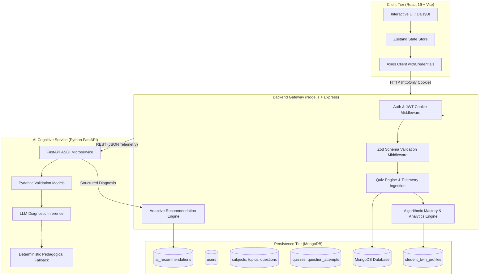

# AI StudyTwin 🎓🤖
> **A Personalized Digital Cognitive Twin & Adaptive Remediation Platform**

[](https://react.dev/)
[](https://nodejs.org/)
[](https://fastapi.tiangolo.com/)
[](https://github.com/)
[](https://jwt.io/)

---

## 📌 Executive Summary & Problem Statement

Traditional Learning Management Systems (LMS) treat all students identically: they administer static quizzes and return flat percentage scores (e.g., *"72% in Computer Science"*). This approach fails to answer three fundamental pedagogical questions:

1. **Root-Cause Analysis:** *Why* did the student miss a specific question? Was it a fundamental theoretical gap, a careless computation slip, or time pressure panic?
2. **Continuous Cognitive Modeling:** What is the student's retention curve, pacing efficiency, and recurring blind spots across granular sub-topics?
3. **Adaptive Remediation:** What exact next action maximizes learning ROI right now?

**AI StudyTwin** solves this problem by synthesizing a **Digital Cognitive Twin** for every student. It continuously ingests fine-grained telemetry (response latency, difficulty weighting, answer revisions, mistake taxonomy) to calculate an algorithmic mastery profile and orchestrate dynamic LLM-driven remediation roadmaps.

---

## 🏛️ System Architecture

AI StudyTwin is designed as a decoupled, microservices-oriented full-stack platform:



---

## ⚡ Core Engineering Innovations

### 1. Granular Question Telemetry & Mistake Taxonomy
Every question attempt tracks comprehensive interaction data:
- **Per-Question Stopwatch Latency:** Time spent before committing to an answer.
- **Cognitive Mistake Taxonomy:**
  - `conceptual`: Fundamental theoretical misunderstanding.
  - `careless`: Slip-up on a familiar topic despite adequate time.
  - `time_pressure`: Errors committed under rushed pacing ($<10\text{s}$).
  - `unattempted`: Questions skipped or expired.

### 2. Transparent Multi-Factor Algorithmic Mastery
Topic mastery ($0 - 100$) is computed via a transparent, deterministic algorithm:
$$\text{Mastery} = 0.45 \cdot \text{Accuracy} + 0.20 \cdot \text{DifficultyWeight} + 0.15 \cdot \text{AttemptVolume} + 0.10 \cdot \text{Recency} + 0.10 \cdot \text{Pacing} - \text{MistakePenalty}$$

Classified across four cognitive tiers:
- **Weak ($<40$):** Immediate conceptual review needed.
- **Developing ($40 - 69$):** Emerging competency requiring focused practice.
- **Strong ($70 - 84$):** Consistent accuracy and pacing.
- **Mastered ($\ge 85$):** Exam-ready stability across difficulty tiers.

### 3. Resilient AI Service with Structured Pydantic Validation
- Ingests aggregated student telemetry: readiness scores, topic proficiencies, repeated error frequencies, and pacing trends.
- Enforces strict JSON output schemas via Pydantic (`DiagnosisResponse`).
- **Resilient Fallback Engine:** If the LLM provider experiences latency spikes or outages, the microservice falls back to deterministic cognitive rules with zero downtime.

### 4. Adaptive Remediation & Action Item Engine
Dynamically generates up to 5 prioritized, deduplicated interventions:
- **High Priority:** Targeted Misconception Drills (recurring errors) and Conceptual Deep Dives (low accuracy + high time).
- **Medium Priority:** Pacing Sprints (high accuracy + high time) and Skill Progression drills.
- **Low Priority:** Spaced Repetition Refreshers for stale topics ($>7$ days without review).

### 5. Enterprise Security & Session Isolation
- **Authentication:** `httpOnly`, `SameSite`, `Secure` JWT cookie sessions. Tokens are never exposed to JavaScript or `localStorage`.
- **API Hardening:** Runtime schema enforcement via `Zod` in Node.js and `Pydantic v2` in Python.
- **Question Sanitization:** Active quiz runners strictly redact correct answers and explanations until formal quiz submission.

---

## 📂 Repository Structure

```text
AI-StudyTwin/
├── frontend/                       # React 19 Client
│   ├── src/
│   │   ├── components/             # Reusable UI (ReadinessRing, MasteryBarChart, DiagnosisCard, etc.)
│   │   ├── layouts/                # AppLayout with DaisyUI responsive navigation
│   │   ├── pages/                  # Route views (Dashboard, Quiz, Analytics, Recommendations, Profile)
│   │   ├── services/               # API clients (auth, quiz, analytics, ai, curriculum)
│   │   ├── store/                  # Zustand persistent auth session slice
│   │   ├── App.jsx                 # Client router with ProtectedRoute guards
│   │   └── main.jsx                # Client bootstrap
│   ├── tailwind.config.js          # Tailwind CSS + DaisyUI theme configuration
│   └── vite.config.js              # Vite configuration with API reverse proxy
│
├── backend/                        # Node.js Express API Gateway
│   ├── config/                     # Database connection & cognitive thresholds
│   ├── controllers/                # Handlers (auth, quiz, analytics, ai, recommendation)
│   ├── middleware/                 # Auth guards & Zod validation middleware
│   ├── models/                     # Mongoose schemas (User, Subject, Topic, Question, Quiz, etc.)
│   ├── routes/                     # REST API route declarations
│   ├── services/                   # Algorithmic mastery & adaptive recommendation engines
│   ├── validators/                 # Zod runtime validation schemas
│   ├── test/                       # Automated test suites (Modules 2, 3, 4, 5, 6, 8)
│   ├── utils/                      # Database seed scripts & JWT helpers
│   └── server.js                   # Express server entry point
│
├── ai-service/                     # Python FastAPI Cognitive Microservice
│   ├── models/                     # Pydantic schemas (DiagnosisRequest, DiagnosisResponse)
│   ├── services/                   # LLM diagnostic prompt engine & deterministic fallback
│   ├── main.py                     # FastAPI application & endpoints (/health, /diagnose)
│   ├── requirements.txt            # Python dependencies (FastAPI, Uvicorn, Pydantic, Pytest)
│   └── test_diagnosis.py           # Pytest unit & integration tests
│
└── README.md                       # Comprehensive Project Documentation
```

---

## 📡 REST API Reference

| Domain | Method | Endpoint | Description | Auth Required |
| :--- | :--- | :--- | :--- | :---: |
| **Health** | `GET` | `/api/v1/health` | Gateway health check | No |
| **Auth** | `POST` | `/api/v1/auth/register` | Register new student profile | No |
| | `POST` | `/api/v1/auth/login` | Authenticate & issue httpOnly cookie | No |
| | `GET` | `/api/v1/auth/me` | Resolve currently authenticated user | **Yes** |
| | `POST` | `/api/v1/auth/logout` | Terminate session & clear cookies | No |
| **Curriculum** | `GET` | `/api/v1/subjects` | List all academic subjects | **Yes** |
| | `GET` | `/api/v1/topics` | List topics (supports `?subjectId=...`) | **Yes** |
| **Quiz Engine** | `POST` | `/api/v1/quizzes/start` | Launch a diagnostic quiz session | **Yes** |
| | `POST` | `/api/v1/quizzes/:id/answer` | Stream real-time question telemetry | **Yes** |
| | `POST` | `/api/v1/quizzes/:id/submit` | Finalize quiz & update cognitive twin | **Yes** |
| | `GET` | `/api/v1/quizzes/:id/result` | Retrieve full post-quiz review | **Yes** |
| | `GET` | `/api/v1/quizzes/history` | Paginated quiz completion history | **Yes** |
| **Analytics** | `GET` | `/api/v1/analytics/overview` | High-level metrics & performance trend | **Yes** |
| | `GET` | `/api/v1/analytics/topics` | Granular topic mastery & tier breakdown | **Yes** |
| | `GET` | `/api/v1/analytics/mistakes` | Mistake taxonomy & recurrence patterns | **Yes** |
| | `GET` | `/api/v1/analytics/readiness` | Overall exam readiness score & coverage | **Yes** |
| **AI Cognitive**| `POST` | `/api/v1/ai/diagnose` | Run AI student diagnosis pipeline | **Yes** |
| | `POST` | `/api/v1/ai/recommendations` | Generate fresh adaptive study plan | **Yes** |
| | `GET` | `/api/v1/ai/recommendations` | Fetch latest active study plan | **Yes** |
| | `GET` | `/api/v1/ai/recommendations/history` | View historical recommendation archive | **Yes** |

---

## 🚀 Getting Started

### Prerequisites
- [Node.js](https://nodejs.org/) (v18.0.0 or higher)
- [Python](https://www.python.org/) (v3.10 or higher)
- [MongoDB](https://www.mongodb.com/) (Local instance or Atlas connection URI)

---

### Step 1: Clone & Configure Environment

```bash
git clone https://github.com/your-username/AI-StudyTwin.git
cd AI-StudyTwin
```

#### Backend Environment (`backend/.env`)
```env
PORT=5000
NODE_ENV=development
MONGODB_URI=mongodb://localhost:27017/ai-studytwin
JWT_SECRET=your_super_secret_jwt_key_here
AI_SERVICE_URL=http://localhost:8000
CLIENT_URL=http://localhost:5173
```

#### AI Service Environment (`ai-service/.env`)
```env
PORT=8000
HOST=127.0.0.1
GEMINI_API_KEY=your_optional_gemini_api_key
```

---

### Step 2: Seed Curriculum Database

Populate initial subjects, topics, and multi-difficulty questions:

```bash
cd backend
npm install
npm run seed
```

---

### Step 3: Launch Service Tiers

#### 1. Start Python AI Microservice
```bash
cd ai-service
# On Windows:
python -m venv venv
.\venv\Scripts\Activate.ps1
pip install -r requirements.txt
uvicorn main:app --reload --port 8000

# On macOS/Linux:
python3 -m venv venv
source venv/bin/activate
pip install -r requirements.txt
uvicorn main:app --reload --port 8000
```
*Microservice active at `http://localhost:8000` (Swagger UI at `/docs`)*

#### 2. Start Node.js Express Gateway
```bash
cd backend
npm run dev
```
*Backend active at `http://localhost:5000`*

#### 3. Start React Client
```bash
cd frontend
npm install
npm run dev
```
*Frontend active at `http://localhost:5173`*

---

## 🧪 Comprehensive Automated Testing

The platform features an automated test suite with **76/76 passing tests** across unit, integration, and full-stack end-to-end scopes:

```bash
# Run complete backend and integration test suite:
cd backend
npm run test:all

# Run specific module test suites:
npm run test:module2    # Auth & Curriculum Models (14 tests)
npm run test:module3    # Quiz Engine & Telemetry Pipeline (12 tests)
npm run test:module4    # Mastery Algorithm & Analytics (14 tests)
npm run test:module5    # FastAPI AI Service Gateway Integration (10 tests)
npm run test:module6    # Adaptive Recommendation Engine (12 tests)
npm run test:module8    # Full-Stack End-to-End Lifecycle & Validation (14 tests)

# Run Python AI service unit tests:
cd ai-service
pytest -v
```

---

## 🏆 Recruiter-Ready Highlights

- **Demonstrated Full-Stack Mastery:** Modern component architecture in React 19, modular Express backend, and asynchronous Python FastAPI microservices.
- **Cognitive Data Science:** Implements mathematical cognitive modeling, moving beyond basic CRUD into telemetry-driven analytics.
- **Defensive Engineering:** Strict runtime input validation (`Zod` + `Pydantic`), resilient fallback algorithms, and secure `httpOnly` cookie authentication.
- **Clean Architecture:** Zero circular dependencies, clear separation of concerns, and full test automation using in-memory databases.

---

## 📄 License
This project is licensed under the MIT License.
